# 🚀 Sarwar Murshed Shatil — Developer Portfolio & Project Showcase

> **Live site:** [https://shatilsarower.github.io/](https://shatilsarower.github.io/)  
> **Repository:** [https://github.com/shatilsarower/shatilsarower.github.io](https://github.com/shatilsarower/shatilsarower.github.io)  
> **Profile:** [https://github.com/shatilsarower](https://github.com/shatilsarower)  
> **Location:** Dhaka, Bangladesh · UTC+06:00  
> **Contact:** sshatil233@gmail.com · [LinkedIn](https://www.linkedin.com/in/shatil-sarower-85211b19b/) · [X/Twitter](https://twitter.com/Shatil86797790)

A lightweight, single-page developer portfolio built with **HTML5, CSS3, JavaScript, Bootstrap 4, and jQuery**, published as a static site through **GitHub Pages**. This repository also serves as the central documentation hub for the Flutter projects pinned on the profile — covering real-time Firebase backends, REST API consumption, custom UI composition, GetX state management, and multi-platform deployment.

---

## 📑 Table of Contents

1. [Portfolio Website Architecture](#1-portfolio-website-architecture)
2. [Project Ecosystem — Overview](#2-project-ecosystem--overview)
3. [Project 1: chatapp3 — Firebase-Powered Chat](#3-project-1-chatapp3--firebase-powered-chat)
4. [Project 2: NewsApp — API-Driven News Reader](#4-project-2-newsapp--api-driven-news-reader)
5. [Project 3: BMI Calculator — Custom Flutter UI](#5-project-3-bmi-calculator--custom-flutter-ui)
6. [Project 4: managment — GetX State Management](#6-project-4-managment--getx-state-management)
7. [Project 5: coffee — Flutter UI Showcase](#7-project-5-coffee--flutter-ui-showcase)
8. [Project 6: Google-Homepage — Multi-Platform Flutter Clone](#8-project-6-google-homepage--multi-platform-flutter-clone)
9. [Downloadable Files & Assets](#9-downloadable-files--assets)
10. [License & Attribution](#10-license--attribution)

---

## 1. Portfolio Website Architecture

### 1.1 Overview

The portfolio is a **static, no-build-step website**. It does not use a server-side application, database, API layer, frontend framework, package manager, or compilation step. The browser loads `index.html`, then loads the referenced stylesheets, images, icons, and JavaScript files.

The site acts as a compact professional profile where visitors can:

1. Read an introductory profile
2. Review education and technical skills
3. Find contact and social links
4. Explore programming-contest and problem-solving profiles
5. Review experience information
6. Open linked CV / resume documents

### 1.2 How the Website Works — Request Flow

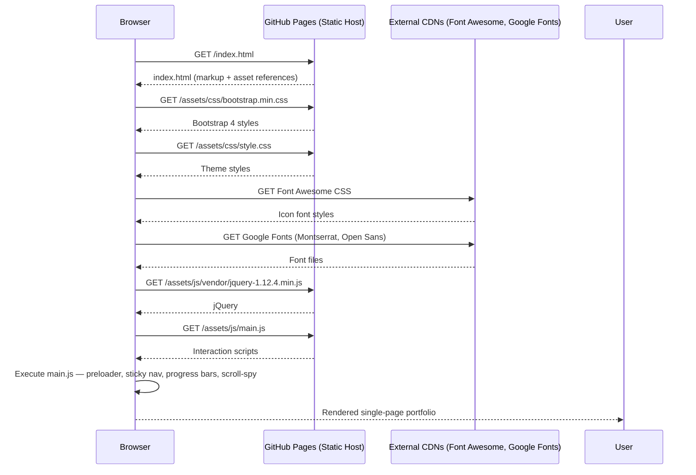

### 1.3 JavaScript Initialization Flow

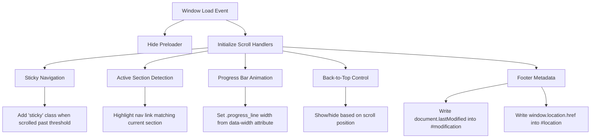

### 1.4 Technology Stack

| Technology          | Role in the Portfolio                          | Version / Note      |
|---------------------|------------------------------------------------|---------------------|
| **HTML5**           | Page structure and portfolio content           | —                   |
| **CSS3**            | Theme styling, layout, responsive rules        | —                   |
| **JavaScript**      | Page interactions and dynamic UI behavior      | Vanilla + jQuery    |
| **Bootstrap**       | Responsive grid, layout utilities              | 4.3.1               |
| **jQuery**          | DOM manipulation and event handling            | 1.12.4              |
| **Popper.js**       | Bootstrap 4 positioning dependency             | —                   |
| **Modernizr**       | Browser feature detection                      | 3.7.1               |
| **jQuery Appear**   | Viewport-entry detection for skill bars        | —                   |
| **jQuery Easing**   | Easing functions for smooth scrolling          | —                   |
| **Scrolling Nav**   | Navigation / scrolling helper                  | —                   |
| **Animate.css**     | CSS animation classes                          | —                   |
| **LineIcons**       | Icon font / classes                            | —                   |
| **Font Awesome**    | Additional icons (CDN)                         | 5.8.1               |
| **Google Fonts**    | Montserrat and Open Sans                       | Loaded from CDN     |

### 1.5 Repository Structure (Runtime-Oriented)

```text
shatilsarower.github.io/
├── index.html
└── new resume/
    └── jackson-master 2/
        └── assets/
            ├── css/
            │   ├── animate.css
            │   ├── lineicons.css
            │   ├── bootstrap.min.css
            │   ├── default.css
            │   └── style.css
            ├── images/
            │   ├── favicon.png
            │   └── hero.png
            └── js/
                ├── popper.min.js
                ├── bootstrap.min.js
                ├── jquery.appear.min.js
                ├── jquery.easing.min.js
                ├── scrolling-nav.js
                ├── main.js
                └── vendor/
                    ├── jquery-1.12.4.min.js
                    └── modernizr-3.7.1.min.js
```

> **Path note:** Asset paths currently contain directory names with spaces (`new resume`, `jackson-master 2`). They work as referenced, but renaming them requires updating every matching `href` / `src` in `index.html`.

### 1.6 Run Locally

```bash
git clone https://github.com/shatilsarower/shatilsarower.github.io.git
cd shatilsarower.github.io
python3 -m http.server 8000
```

Open `http://localhost:8000`. Using an HTTP server is preferable to a `file://` URL.

### 1.7 Deployment with GitHub Pages

The repository name follows GitHub’s user-site convention (`username.github.io`). The live site is served from the `master` branch root.

```bash
git status
git add index.html "new resume"
git commit -m "Update portfolio content"
git push origin master
```

---

## 2. Project Ecosystem — Overview

The profile pins six repositories that demonstrate a focused journey through **Flutter development** — from Firebase-backed real-time chat to API-driven data consumption, custom UI engineering, state management with GetX, and multi-platform deployment.

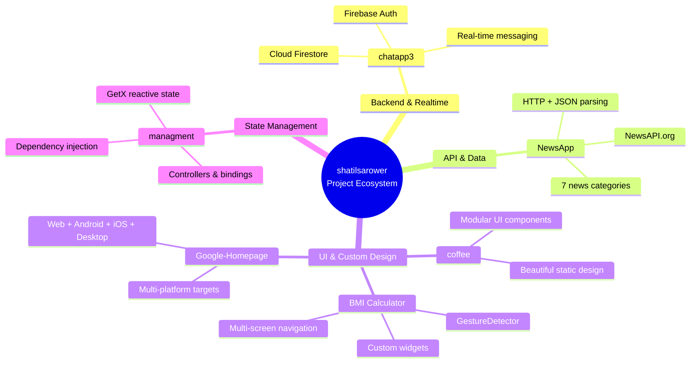

| Project            | Primary Focus                     | Key Technologies                  | Stars (approx.) |
|--------------------|-----------------------------------|-----------------------------------|-----------------|
| **chatapp3**       | Real-time chat                    | Flutter, Firebase Auth, Firestore | 4               |
| **NewsApp**        | REST API consumption              | Flutter, http, NewsAPI.org        | 4               |
| **bmi-calculator** | Custom UI & multi-screen flow     | Flutter, Themes, Navigator        | 1               |
| **managment**      | GetX state management             | Flutter, GetX                     | 5               |
| **coffee**         | Beautiful modular UI              | Flutter                           | 7               |
| **Google-Homepage**| Multi-platform clone              | Flutter (all platforms)           | 1               |

---

## 3. Project 1: chatapp3 — Firebase-Powered Chat

**Repository:** [https://github.com/shatilsarower/chatapp3](https://github.com/shatilsarower/chatapp3)

### 3.1 Description

A Flutter chat application built on **Firebase** as the backend. It demonstrates real-time data synchronization, user authentication, and the core building blocks of a production-ready messaging system.

### 3.2 High-Level Architecture

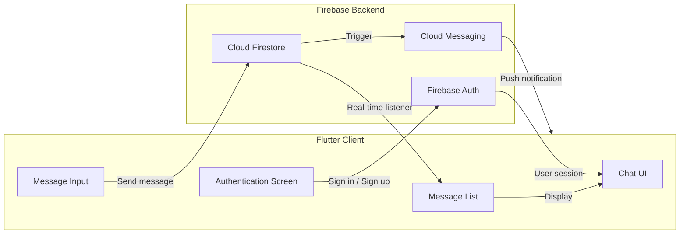

### 3.3 Message Lifecycle Sequence

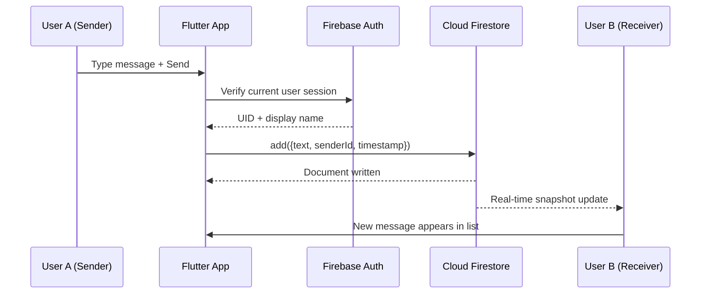

### 3.4 Key Technical Decisions

| Decision            | Rationale                                                                 |
|---------------------|---------------------------------------------------------------------------|
| **Firebase Auth**   | Offloads authentication complexity; supports email/password & federated providers |
| **Cloud Firestore** | Real-time listeners eliminate polling; offline persistence helps on unstable networks |
| **Flutter**         | Single codebase for Android & iOS; hot reload accelerates UI iteration     |

---

## 4. Project 2: NewsApp — API-Driven News Reader

**Repository:** [https://github.com/shatilsarower/NewsApp](https://github.com/shatilsarower/NewsApp)

### 4.1 Description

A Flutter application that displays **7 types of news** fetched from the **NewsAPI.org** REST API. It demonstrates HTTP requests, JSON parsing, model classes, and dynamic list rendering.

### 4.2 Data Flow

```mermaid
sequenceDiagram
    participant User
    participant UI as Flutter UI
    participant Service as News Service
    participant API as NewsAPI.org

    User->>UI: Open category (e.g. Technology)
    UI->>Service: requestNews(category)
    Service->>API: GET /v2/top-headlines?category=technology&apiKey=...
    API-->>Service: JSON response (articles array)
    Service->>Service: Parse JSON → List&lt;Article&gt;
    Service-->>UI: Return List&lt;Article&gt;
    UI->>UI: Build ListView with article cards
    UI-->>User: Display headlines, images, sources
```

### 4.3 Category Routing

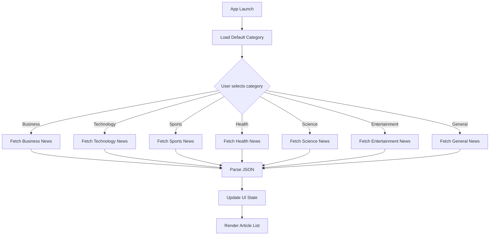

### 4.4 Key Learning Outcomes

- Consuming a third-party REST API with the `http` package
- Handling asynchronous operations with `FutureBuilder` / `async`–`await`
- Mapping JSON to Dart model classes
- Managing loading, success, and error states in the UI

---

## 5. Project 3: BMI Calculator — Custom Flutter UI

**Repository:** [https://github.com/shatilsarower/bmi-calculator](https://github.com/shatilsarower/bmi-calculator)

### 5.1 Description

A multi-screen Body Mass Index calculator inspired by a **Ruben Vaalt** design. The project focuses on **custom widget composition**, **theme consistency**, and **navigation** rather than complex business logic.

### 5.2 Screen Navigation Flow

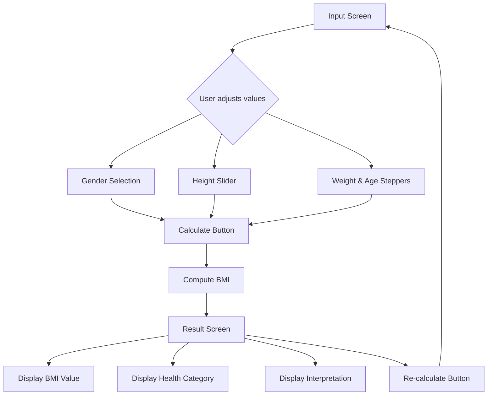

### 5.3 Widget Composition Strategy

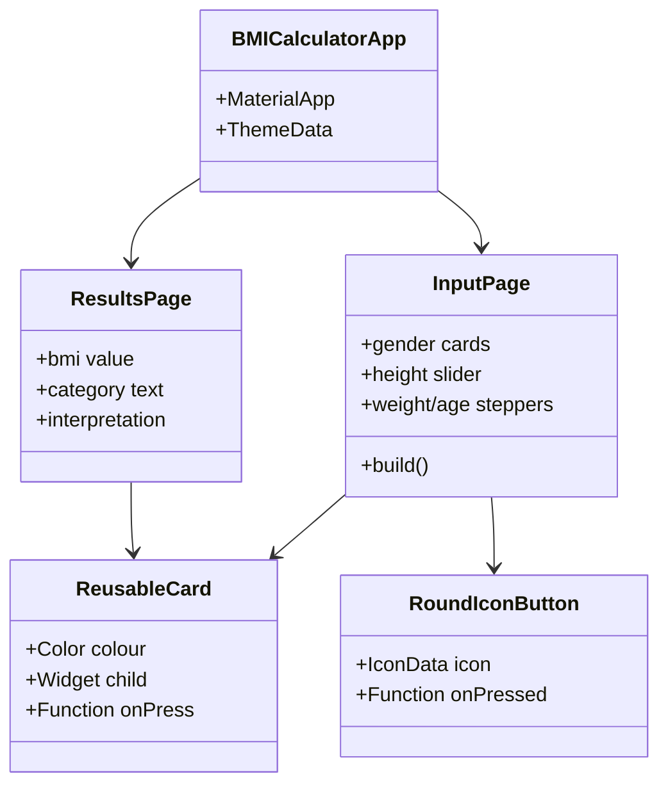

### 5.4 BMI Calculation Logic

```
BMI = weight (kg) / [height (m)]²
```

Categories (WHO approximate):

| BMI Range     | Category     |
|---------------|--------------|
| < 18.5        | Underweight  |
| 18.5 – 24.9   | Normal       |
| 25.0 – 29.9   | Overweight   |
| ≥ 30.0        | Obese        |

---

## 6. Project 4: managment — GetX State Management

**Repository:** [https://github.com/shatilsarower/managment](https://github.com/shatilsarower/managment)

### 6.1 Description

A focused Flutter project created to learn **state management with GetX**. It demonstrates reactive variables, controllers, dependency injection, and route management without the boilerplate of Provider or Bloc.

### 6.2 GetX Architecture Flow

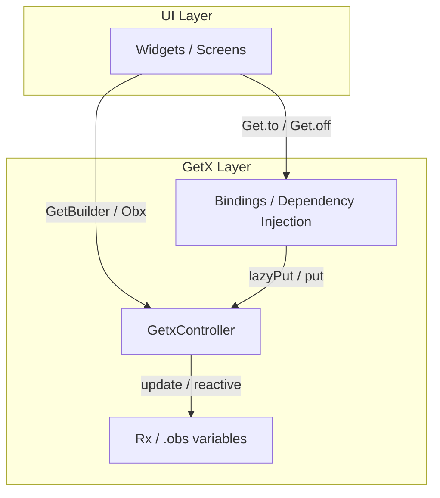

### 6.3 Typical Controller Pattern

```dart
class CounterController extends GetxController {
  var count = 0.obs;          // reactive variable

  void increment() => count++;
  void decrement() => count--;
}
```

UI rebuilds automatically when `count` changes via `Obx(() => Text('${controller.count}'))`.

---

## 7. Project 5: coffee — Flutter UI Showcase

**Repository:** [https://github.com/shatilsarower/coffee](https://github.com/shatilsarower/coffee)

### 7.1 Description

A simple, beautiful coffee-shop style application UI built with Flutter. Emphasis is on **modular component design**, clean visual hierarchy, and polished static screens rather than backend integration.

### 7.2 UI Component Hierarchy

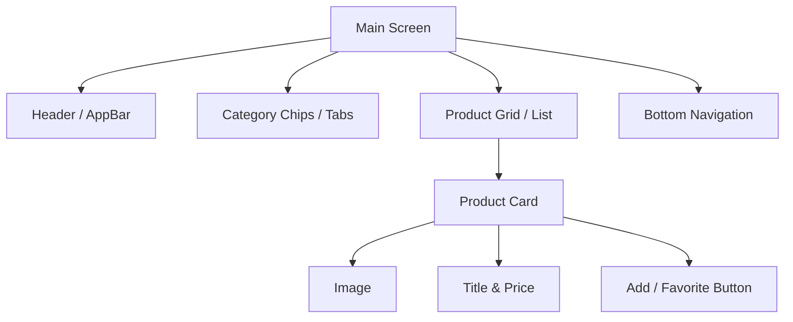

### 7.3 Design Goals

- Consistent spacing and typography
- Reusable card and button components
- Smooth visual transitions
- Ready foundation for later state management or API integration

---

## 8. Project 6: Google-Homepage — Multi-Platform Flutter Clone

**Repository:** [https://github.com/shatilsarower/Google-Homepage](https://github.com/shatilsarower/Google-Homepage)

### 8.1 Description

A Flutter recreation of the classic Google homepage that targets **multiple platforms** (Android, iOS, Web, Linux, macOS, Windows). It demonstrates Flutter’s “write once, run everywhere” capability with a familiar UI.

### 8.2 Multi-Platform Build Targets

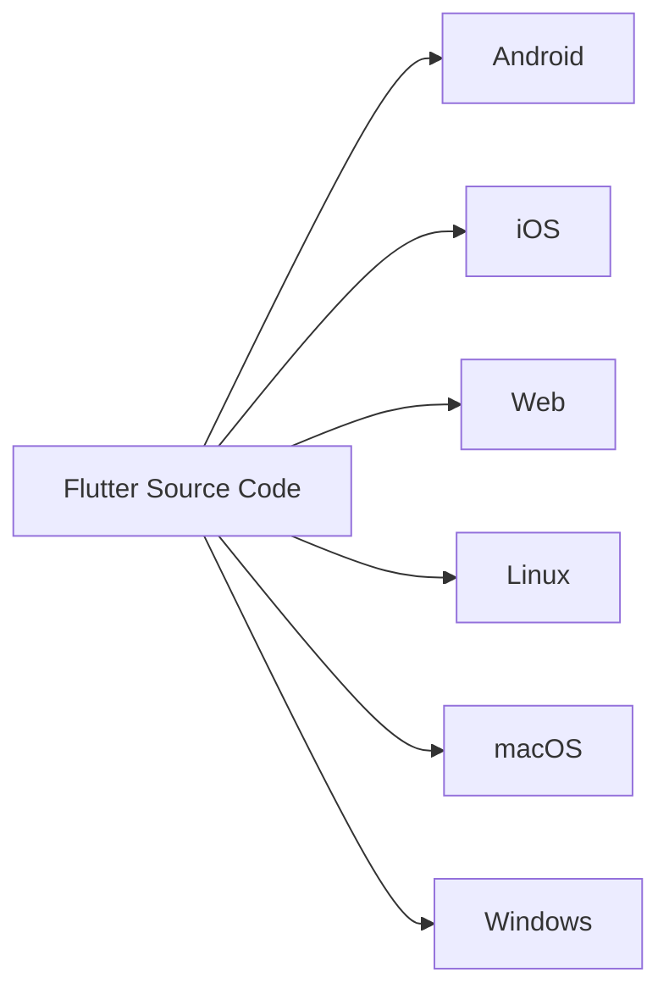

### 8.3 Typical Development Commands

```bash
flutter run -d chrome          # Web
flutter run -d android         # Android emulator / device
flutter run -d macos           # macOS desktop
flutter build web              # Production web build
flutter build apk --release    # Android release APK
```

---

## 9. Downloadable Files & Assets

All files generated for this documentation package are available in the accompanying downloadable archive / folder:

| File | Description |
|------|-------------|
| `README.md` | This hyper-detailed modern README (the file you are reading) |
| `ARCHITECTURE.md` | Condensed architecture notes + mermaid source for the portfolio site |
| `PROJECTS_OVERVIEW.md` | One-page summary of the six Flutter projects with key links |
| `diagrams/` | Folder containing individual mermaid / flowchart source files for easy reuse |
| `portfolio-structure.txt` | Plain-text tree of the current repository layout |

### How to obtain the files

1. **From this conversation / artifact package** – download the entire `shatilsarower-portfolio-readme` folder.
2. **Commit to the repository** – copy `README.md` (and optionally the supporting files) into the root of `shatilsarower.github.io` and push.
3. **GitHub raw links** (after commit):

```
https://raw.githubusercontent.com/shatilsarower/shatilsarower.github.io/master/README.md
```

---

## 10. License & Attribution

- Portfolio theme assets are based on publicly available Bootstrap / jQuery templates.  
- Individual Flutter projects are original learning exercises by **Sarwar Murshed Shatil** (`@shatilsarower`).  
- Third-party services used: Firebase, NewsAPI.org, Google Fonts, Font Awesome.  
- Feel free to fork, star, and adapt the code for learning purposes.

---

### 🙋‍♂️ About the Author

**Sarwar Murshed Shatil**  
Passionate developer from Bangladesh currently learning Flutter, Data Structures & Algorithms, Object-Oriented Programming, Clean Code, and System Design.  
Looking to collaborate on open-source projects.

- 📧 **Email:** sshatil233@gmail.com  
- 🌐 **Portfolio:** https://shatilsarower.github.io/  
- 💼 **LinkedIn:** [shatil-sarower](https://www.linkedin.com/in/shatil-sarower-85211b19b/)  
- 🐦 **X:** [@Shatil86797790](https://twitter.com/Shatil86797790)

---

*This README was generated as a comprehensive, modern reference for the `shatilsarower.github.io` repository and the key Flutter projects on the profile. Update it whenever the page structure, dependencies, or project behavior changes.*
