# 🚀 Sarwar Murshed Shatil — Developer Portfolio & Project Showcase

> **Live site:** [https://shatilsarower.github.io/](https://shatilsarower.github.io/)  
> **Repository:** [https://github.com/shatilsarower/shatilsarower.github.io](https://github.com/shatilsarower/shatilsarower.github.io)  
> **Profile:** [https://github.com/shatilsarower](https://github.com/shatilsarower)  
> **Location:** Dhaka, Bangladesh · UTC+06:00  
> **Contact:** sshatil233@gmail.com · [LinkedIn](https://www.linkedin.com/in/shatil-sarower-85211b19b/) · [X/Twitter](https://twitter.com/Shatil86797790)

A lightweight, single-page developer portfolio built with **HTML5, CSS3, JavaScript, Bootstrap 4, and jQuery**, published as a static site through **GitHub Pages**. This repository also serves as the central documentation hub for the Flutter projects pinned on the profile — covering real-time Firebase backends, REST API consumption, custom UI composition, GetX state management, and multi-platform deployment.

---

## 📑 Table of Contents

1. [Portfolio Website Architecture](#1-portfolio-website-architecture)
2. [Project Ecosystem — Overview](#2-project-ecosystem--overview)
3. [Project 1: chatapp3 — Firebase-Powered Chat](#3-project-1-chatapp3--firebase-powered-chat)
4. [Project 2: NewsApp — API-Driven News Reader](#4-project-2-newsapp--api-driven-news-reader)
5. [Project 3: BMI Calculator — Custom Flutter UI](#5-project-3-bmi-calculator--custom-flutter-ui)
6. [Project 4: managment — GetX State Management](#6-project-4-managment--getx-state-management)
7. [Project 5: coffee — Flutter UI Showcase](#7-project-5-coffee--flutter-ui-showcase)
8. [Project 6: Google-Homepage — Multi-Platform Flutter Clone](#8-project-6-google-homepage--multi-platform-flutter-clone)
9. [Downloadable Files & Assets](#9-downloadable-files--assets)
10. [License & Attribution](#10-license--attribution)

---

## 1. Portfolio Website Architecture

### 1.1 Overview

The portfolio is a **static, no-build-step website**. It does not use a server-side application, database, API layer, frontend framework, package manager, or compilation step. The browser loads `index.html`, then loads the referenced stylesheets, images, icons, and JavaScript files.

The site acts as a compact professional profile where visitors can:

1. Read an introductory profile
2. Review education and technical skills
3. Find contact and social links
4. Explore programming-contest and problem-solving profiles
5. Review experience information
6. Open linked CV / resume documents

### 1.2 How the Website Works — Request Flow

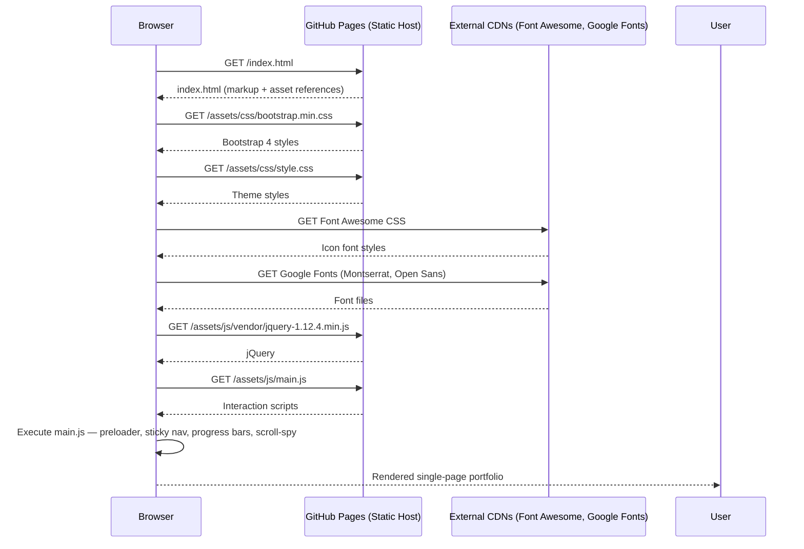

### 1.3 JavaScript Initialization Flow

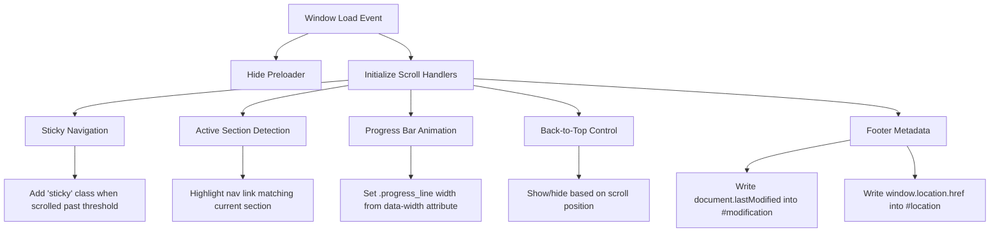

### 1.4 Technology Stack

| Technology          | Role in the Portfolio                          | Version / Note      |
|---------------------|------------------------------------------------|---------------------|
| **HTML5**           | Page structure and portfolio content           | —                   |
| **CSS3**            | Theme styling, layout, responsive rules        | —                   |
| **JavaScript**      | Page interactions and dynamic UI behavior      | Vanilla + jQuery    |
| **Bootstrap**       | Responsive grid, layout utilities              | 4.3.1               |
| **jQuery**          | DOM manipulation and event handling            | 1.12.4              |
| **Popper.js**       | Bootstrap 4 positioning dependency             | —                   |
| **Modernizr**       | Browser feature detection                      | 3.7.1               |
| **jQuery Appear**   | Viewport-entry detection for skill bars        | —                   |
| **jQuery Easing**   | Easing functions for smooth scrolling          | —                   |
| **Scrolling Nav**   | Navigation / scrolling helper                  | —                   |
| **Animate.css**     | CSS animation classes                          | —                   |
| **LineIcons**       | Icon font                                      | —                   |
| **Font Awesome**    | Additional icons (CDN)                         | 5.8.1               |
| **Google Fonts**    | Montserrat & Open Sans                         | CDN                 |

### 1.5 Repository Structure (Runtime-Oriented)

```text
shatilsarower.github.io/
├── index.html
└── new resume/
    └── jackson-master 2/
        └── assets/
            ├── css/
            │   ├── animate.css
            │   ├── lineicons.css
            │   ├── bootstrap.min.css
            │   ├── default.css
            │   └── style.css
            ├── images/
            │   ├── favicon.png
            │   └── hero.png
            └── js/
                ├── popper.min.js
                ├── bootstrap.min.js
                ├── jquery.appear.min.js
                ├── jquery.easing.min.js
                ├── scrolling-nav.js
                ├── main.js
                └── vendor/
                    ├── jquery-1.12.4.min.js
                    └── modernizr-3.7.1.min.js
```

> **Path note:** Directory names contain spaces (`new resume`, `jackson-master 2`). They work as referenced by the current HTML, but are more awkward to maintain.

### 1.6 Run Locally

```bash
git clone https://github.com/shatilsarower/shatilsarower.github.io.git
cd shatilsarower.github.io
python3 -m http.server 8000
```

Open `http://localhost:8000`. No Node.js, npm, or build step is required.

### 1.7 Deploy with GitHub Pages

The repository name follows the user-site convention. Pushing to the `master` branch publishes the site at `https://shatilsarower.github.io/`.

```bash
git add .
git commit -m "Update portfolio content"
git push origin master
```

---

## 2. Project Ecosystem — Overview

The profile pins six repositories that collectively demonstrate a focused journey through **Flutter development** — from Firebase-backed real-time chat to API-driven data consumption, custom UI engineering, state management with GetX, and multi-platform deployment.

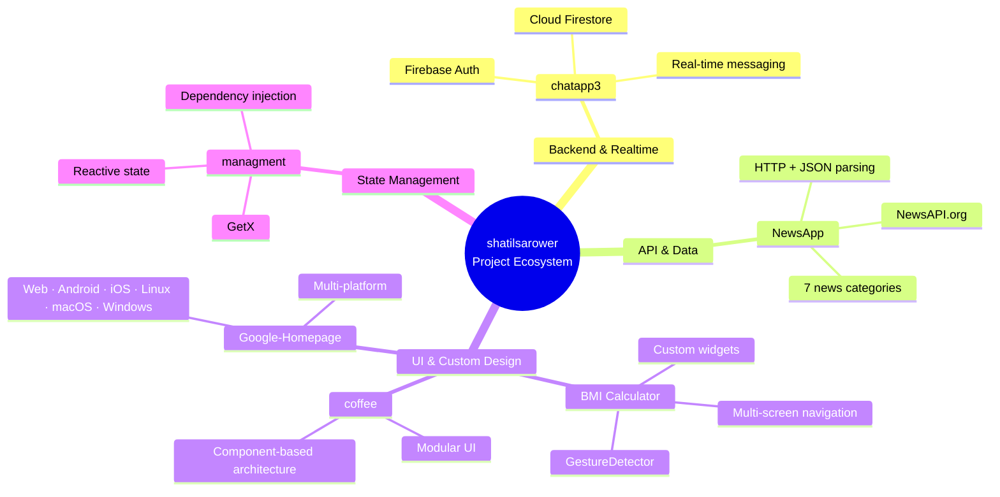

| Project            | Primary Focus                     | Key Tech                          | Stars |
|--------------------|-----------------------------------|-----------------------------------|-------|
| chatapp3           | Real-time chat                    | Flutter + Firebase                | 4     |
| NewsApp            | REST API consumption              | Flutter + http + NewsAPI          | 4     |
| bmi-calculator     | Custom UI & navigation            | Flutter (custom widgets)          | 1     |
| managment          | State management                  | Flutter + GetX                    | 5     |
| coffee             | Beautiful modular UI              | Flutter UI                        | 7     |
| Google-Homepage    | Multi-platform clone              | Flutter (all platforms)           | 1     |

---

## 3. Project 1: chatapp3 — Firebase-Powered Chat

**Repository:** [https://github.com/shatilsarower/chatapp3](https://github.com/shatilsarower/chatapp3)  
**Language:** Dart (Flutter)  
**Backend:** Firebase (Auth + Cloud Firestore)

### 3.1 Description

A Flutter chat application that demonstrates real-time data synchronization, user authentication, and the foundational patterns of a production chat system.

### 3.2 Architecture Flow

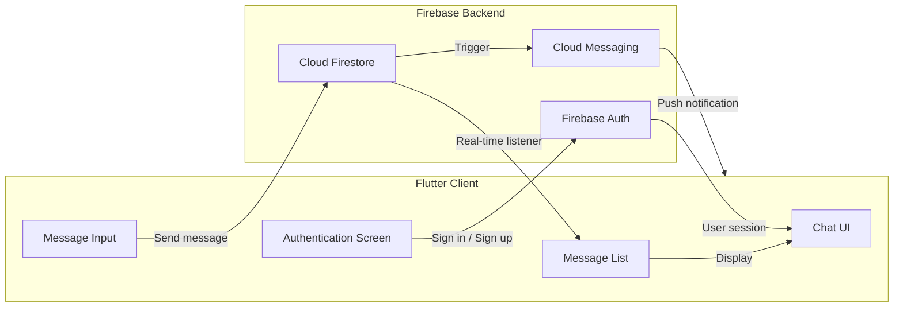

### 3.3 Key Technical Decisions

| Decision              | Rationale                                                                 |
|-----------------------|---------------------------------------------------------------------------|
| Firebase Auth         | Offloads authentication complexity; supports email/password and providers |
| Cloud Firestore       | Real-time listeners eliminate polling; offline persistence helps reliability |
| Flutter UI            | Single codebase for Android & iOS; hot reload accelerates iteration       |

### 3.4 Typical Usage

```bash
git clone https://github.com/shatilsarower/chatapp3.git
cd chatapp3
flutter pub get
# Configure Firebase (google-services.json / GoogleService-Info.plist)
flutter run
```

---

## 4. Project 2: NewsApp — API-Driven News Reader

**Repository:** [https://github.com/shatilsarower/NewsApp](https://github.com/shatilsarower/NewsApp)  
**Language:** Dart (Flutter)  
**API:** [NewsAPI.org](https://newsapi.org/)

### 4.1 Description

A Flutter application that displays **7 categories of news** fetched from the NewsAPI.org REST API. Demonstrates HTTP requests, JSON parsing, model classes, and dynamic list rendering.

### 4.2 Data Flow

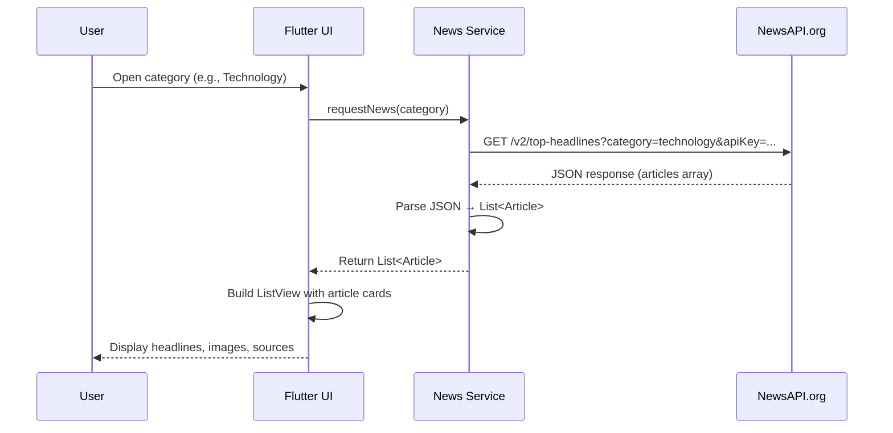

### 4.3 Category Routing

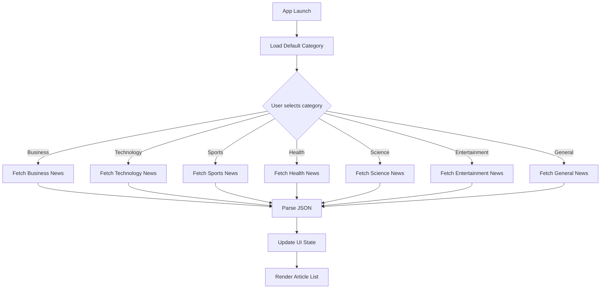

### 4.4 Key Learning Outcomes

- Consuming a third-party REST API with the `http` package
- Handling asynchronous operations with `FutureBuilder` / `async`–`await`
- Mapping JSON to Dart model classes
- Managing loading, success, and error states in the UI

### 4.5 Typical Usage

```bash
git clone https://github.com/shatilsarower/NewsApp.git
cd NewsApp
flutter pub get
# Add your NewsAPI.org key where required
flutter run
```

---

## 5. Project 3: BMI Calculator — Custom Flutter UI

**Repository:** [https://github.com/shatilsarower/bmi-calculator](https://github.com/shatilsarower/bmi-calculator)  
**Language:** Dart (Flutter)  
**Focus:** Custom widgets, themes, multi-screen navigation

### 5.1 Description

A multi-screen Body Mass Index calculator inspired by the Ruben Vaalt design. Emphasizes **custom widget composition**, **theme consistency**, and **navigation** rather than complex business logic.

### 5.2 Screen Navigation Flow

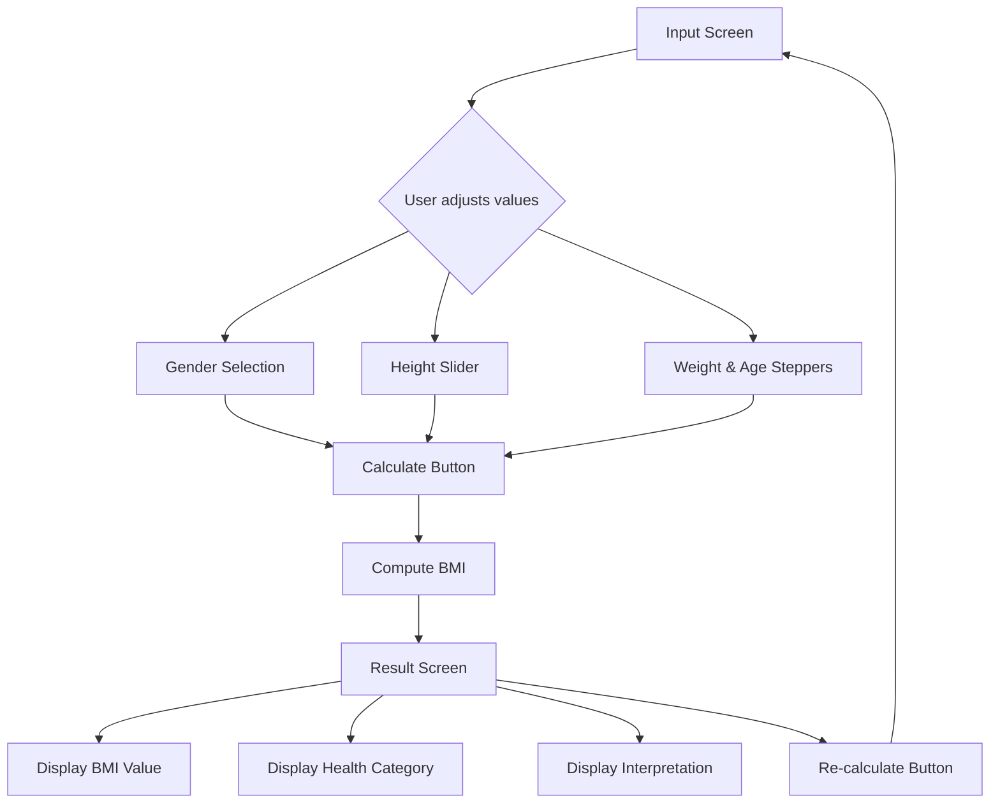

### 5.3 Widget Composition Strategy

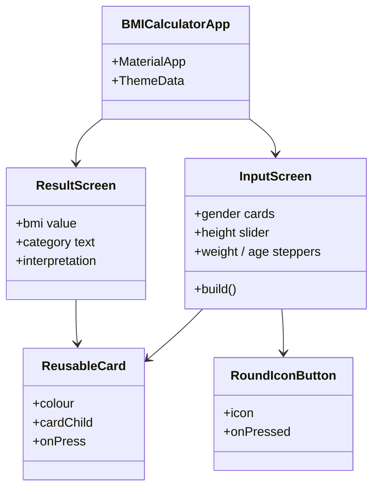

### 5.4 What You Learn

- Flutter themes for coherent branding
- Multi-page apps with Routes & Navigator
- Extracting and refactoring widgets
- Passing functions as parameters
- GestureDetector beyond simple taps
- Custom colour palettes with hex codes
- Composition vs inheritance in Flutter UI

### 5.5 Typical Usage

```bash
git clone https://github.com/shatilsarower/bmi-calculator.git
cd bmi-calculator
flutter pub get
flutter run
```

---

## 6. Project 4: managment — GetX State Management

**Repository:** [https://github.com/shatilsarower/managment](https://github.com/shatilsarower/managment)  
**Language:** Dart (Flutter)  
**State Management:** GetX

### 6.1 Description

A learning-focused Flutter project that explores **state management with GetX** — reactive variables, controllers, dependency injection, and route management.

### 6.2 GetX Architecture Flow

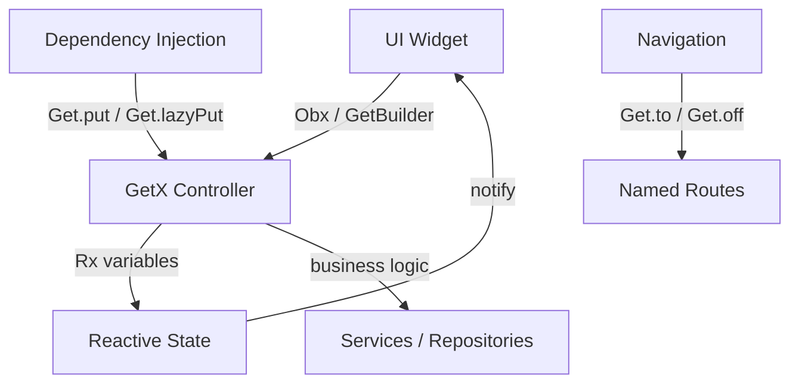

### 6.3 Core GetX Patterns Used

| Pattern                | Purpose                                      |
|------------------------|----------------------------------------------|
| `GetxController`       | Holds business logic and reactive state      |
| `Obx` / `GetBuilder`   | Rebuild UI when observed values change       |
| `Get.put()`            | Register controllers / services              |
| `Get.to()` / `Get.off()` | Declarative navigation without context     |
| Reactive types (`Rx`)  | Fine-grained reactivity                      |

### 6.4 Typical Usage

```bash
git clone https://github.com/shatilsarower/managment.git
cd managment
flutter pub get
flutter run
```

---

## 7. Project 5: coffee — Flutter UI Showcase

**Repository:** [https://github.com/shatilsarower/coffee](https://github.com/shatilsarower/coffee)  
**Language:** Dart (Flutter)  
**Focus:** Visually rich, modular UI

### 7.1 Description

A beautiful Flutter UI showcasing a coffee-themed application concept. Demonstrates clean, modular UI design and serves as both inspiration and a foundation for UI-centric Flutter experiments.

### 7.2 UI Architecture

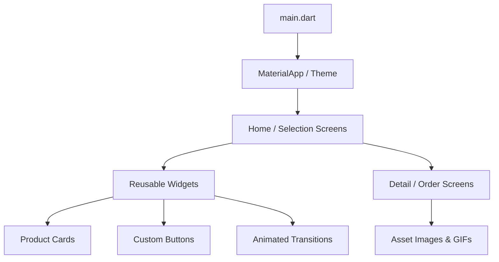

### 7.3 Project Structure (High-Level)

```text
coffee/
├── android/ ios/ macos/
├── lib/
│   ├── screens/          # UI Screens
│   ├── widgets/          # Reusable widgets
│   ├── models/           # Data models
│   └── main.dart
├── asstes/               # Images, GIFs (note spelling)
├── test/
└── pubspec.yaml
```

### 7.4 Features

- Visually appealing coffee selection screens
- Smooth transitions and modular widget implementations
- Clean, component-based architecture for UI scalability
- Flutter best practices for layout and styling

### 7.5 Typical Usage

```bash
git clone https://github.com/shatilsarower/coffee.git
cd coffee
flutter pub get
flutter run
```

---

## 8. Project 6: Google-Homepage — Multi-Platform Flutter Clone

**Repository:** [https://github.com/shatilsarower/Google-Homepage](https://github.com/shatilsarower/Google-Homepage)  
**Language:** Dart (Flutter)  
**Platforms:** Web, Android, iOS, Linux, macOS, Windows

### 8.1 Description

A Flutter project that clones the Google homepage experience and is configured for **all major Flutter targets**, demonstrating multi-platform capability from a single codebase.

### 8.2 Multi-Platform Architecture

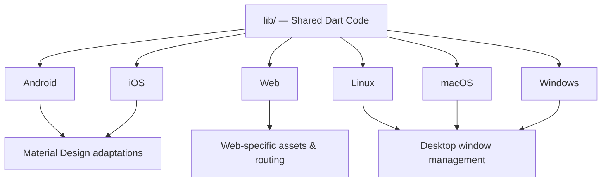

### 8.3 Platform Support Matrix

| Platform | Folder   | Notes                          |
|----------|----------|--------------------------------|
| Android  | `android/` | Standard Flutter Android embedder |
| iOS      | `ios/`     | Xcode project                  |
| Web      | `web/`     | Flutter web target             |
| Linux    | `linux/`   | Desktop Linux                  |
| macOS    | `macos/`   | Desktop macOS                  |
| Windows  | `windows/` | Desktop Windows                |

### 8.4 Typical Usage

```bash
git clone https://github.com/shatilsarower/Google-Homepage.git
cd Google-Homepage
flutter pub get

# Run on desired platform
flutter run -d chrome          # Web
flutter run -d windows         # Windows
flutter run -d linux           # Linux
flutter run                    # Mobile (connected device / emulator)
```

---

## 9. Downloadable Files & Assets

All source code is publicly available. Use the links below to download ZIP archives or clone the repositories.

### 9.1 Portfolio Repository

| Item | Link |
|------|------|
| **Clone** | `git clone https://github.com/shatilsarower/shatilsarower.github.io.git` |
| **ZIP Download** | [Download ZIP](https://github.com/shatilsarower/shatilsarower.github.io/archive/refs/heads/master.zip) |
| **This README (raw)** | [Raw README.md](https://raw.githubusercontent.com/shatilsarower/shatilsarower.github.io/master/README.md) |

### 9.2 Individual Projects — Clone & ZIP

| Project | Clone Command | ZIP Download |
|---------|---------------|--------------|
| **chatapp3** | `git clone https://github.com/shatilsarower/chatapp3.git` | [Download ZIP](https://github.com/shatilsarower/chatapp3/archive/refs/heads/master.zip) |
| **NewsApp** | `git clone https://github.com/shatilsarower/NewsApp.git` | [Download ZIP](https://github.com/shatilsarower/NewsApp/archive/refs/heads/master.zip) |
| **bmi-calculator** | `git clone https://github.com/shatilsarower/bmi-calculator.git` | [Download ZIP](https://github.com/shatilsarower/bmi-calculator/archive/refs/heads/master.zip) |
| **managment** | `git clone https://github.com/shatilsarower/managment.git` | [Download ZIP](https://github.com/shatilsarower/managment/archive/refs/heads/master.zip) |
| **coffee** | `git clone https://github.com/shatilsarower/coffee.git` | [Download ZIP](https://github.com/shatilsarower/coffee/archive/refs/heads/master.zip) |
| **Google-Homepage** | `git clone https://github.com/shatilsarower/Google-Homepage.git` | [Download ZIP](https://github.com/shatilsarower/Google-Homepage/archive/refs/heads/master.zip) |

### 9.3 One-Liner to Download All Project ZIPs

```bash
mkdir -p shatil-projects && cd shatil-projects
curl -L -o portfolio.zip https://github.com/shatilsarower/shatilsarower.github.io/archive/refs/heads/master.zip
curl -L -o chatapp3.zip https://github.com/shatilsarower/chatapp3/archive/refs/heads/master.zip
curl -L -o NewsApp.zip https://github.com/shatilsarower/NewsApp/archive/refs/heads/master.zip
curl -L -o bmi-calculator.zip https://github.com/shatilsarower/bmi-calculator/archive/refs/heads/master.zip
curl -L -o managment.zip https://github.com/shatilsarower/managment/archive/refs/heads/master.zip
curl -L -o coffee.zip https://github.com/shatilsarower/coffee/archive/refs/heads/master.zip
curl -L -o Google-Homepage.zip https://github.com/shatilsarower/Google-Homepage/archive/refs/heads/master.zip
```

### 9.4 This Final README

The file you are reading is available for download from the artifacts of this generation session (or can be copied directly from the repository once committed).

---

## 10. License & Attribution

- The portfolio website and the individual Flutter projects are published under the terms chosen by the repository owner (check each repository’s LICENSE file where present).
- Bootstrap, jQuery, Font Awesome, and other third-party libraries retain their original licenses.
- NewsAPI.org usage is subject to the NewsAPI terms of service and requires your own API key for production use.
- Firebase projects require your own Firebase project configuration files.

---

**Maintained by Sarwar Murshed Shatil**  
Dhaka, Bangladesh · [https://shatilsarower.github.io/](https://shatilsarower.github.io/)

*This README is a consolidated, modern reference designed to be downloaded, committed, and used immediately. Update it whenever the page structure, dependencies, or project behavior changes.*
