This README is a consolidated, modern reference for the `shatilsarower.github.io` repository and the key projects on the profile. It is designed as a single file you can download, commit, and use immediately.

---

# 🚀 Sarwar Murshed Shatil — Developer Portfolio & Project Showcase

> **Live site:** [https://shatilsarower.github.io/](https://shatilsarower.github.io/)  
> **Repository:** [https://github.com/shatilsarower/shatilsarower.github.io](https://github.com/shatilsarower/shatilsarower.github.io)  
> **Profile:** [https://github.com/shatilsarower](https://github.com/shatilsarower)

A lightweight, single-page developer portfolio built with **HTML5, CSS3, JavaScript, Bootstrap 4, and jQuery**, published as a static site through **GitHub Pages**. The repository also serves as the central hub for the projects pinned on the profile — Flutter applications covering state management, API integration, UI design, Firebase backends, and multi-platform development.

---

## 📑 Table of Contents

1. [Portfolio Website Architecture](#1-portfolio-website-architecture)
2. [Project Ecosystem — Overview](#2-project-ecosystem--overview)
3. [Project 1: chatapp3 — Firebase-Powered Chat](#3-project-1-chatapp3--firebase-powered-chat)
4. [Project 2: NewsApp — API-Driven News Reader](#4-project-2-newsapp--api-driven-news-reader)
5. [Project 3: BMI Calculator — Custom Flutter UI](#5-project-3-bmi-calculator--custom-flutter-ui)
6. [Project 4: managment — GetX State Management](#6-project-4-managment--getx-state-management)
7. [Project 5: coffee — Flutter UI Showcase](#7-project-5-coffee--flutter-ui-showcase)
8. [Project 6: Google-Homepage — Multi-Platform Flutter Clone](#8-project-6-google-homepage--multi-platform-flutter-clone)
9. [Downloadable Files](#9-downloadable-files)
10. [License & Attribution](#10-license--attribution)

---

## 1. Portfolio Website Architecture

### 1.1 Overview

The portfolio is a **static, no-build-step website**. It does not use a server-side application, database, API layer, frontend framework, package manager, or compilation step. The browser loads `index.html`, then loads the referenced stylesheet, image, icon, and JavaScript files.

The site acts as a compact professional profile where visitors can read an introductory profile, review education and technical skills, find contact and social links, explore programming-contest profiles, review experience, and open linked CV/resume documents.

### 1.2 How the Website Works — Request Flow

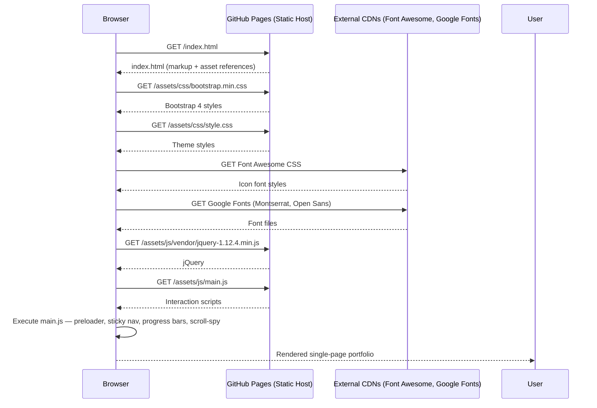

### 1.3 JavaScript Initialization Flow

The `main.js` script registers handlers for page load and scroll events. Its behavior includes hiding the preloader after the window loads, adding/removing the `sticky` class on the navigation bar, updating the active navigation item based on scroll position, closing the collapsed navigation after a link click, animating skill progress bars when they enter the viewport, and writing the document’s last-modified date and current page URL into the footer.

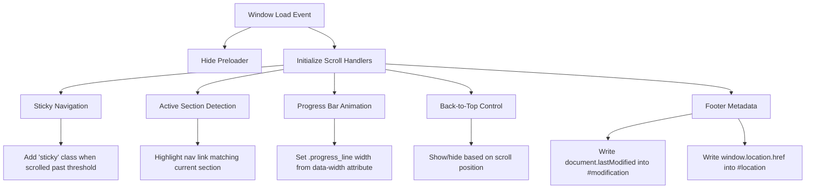

### 1.4 Technology Stack

| Technology | Role in the Portfolio | Version / Note |
|---|---|---|
| **HTML5** | Page structure and portfolio content | — |
| **CSS3** | Theme styling, layout, responsive rules, visual effects | — |
| **JavaScript** | Page interactions and dynamic UI behavior | Vanilla JS + jQuery plugins |
| **Bootstrap** | Responsive grid, layout utilities, component styling | 4.3.1 |
| **jQuery** | DOM manipulation and event handling | 1.12.4 |
| **Popper.js** | Bootstrap 4 positioning dependency | — |
| **Modernizr** | Browser feature detection | 3.7.1 |
| **jQuery Appear** | Viewport-entry detection for skill bars | — |
| **jQuery Easing** | Easing functions for smooth scrolling | — |
| **Scrolling Nav** | Navigation/scrolling helper | — |
| **Animate.css** | CSS animation classes | — |
| **LineIcons** | Icon font/classes | — |
| **Font Awesome** | Additional icons (CDN) | 5.8.1 |
| **Google Fonts** | Montserrat and Open Sans | Loaded from CDN |

### 1.5 Repository Structure (Runtime-Oriented)

```
shatilsarower.github.io/
├── index.html
└── new resume/
    └── jackson-master 2/
        └── assets/
            ├── css/
            │   ├── animate.css
            │   ├── lineicons.css
            │   ├── bootstrap.min.css
            │   ├── default.css
            │   └── style.css
            ├── images/
            │   ├── favicon.png
            │   └── hero.png
            └── js/
                ├── popper.min.js
                ├── bootstrap.min.js
                ├── jquery.appear.min.js
                ├── jquery.easing.min.js
                ├── scrolling-nav.js
                ├── main.js
                └── vendor/
                    ├── jquery-1.12.4.min.js
                    └── modernizr-3.7.1.min.js
```

> **Path note:** The asset paths include directory names with spaces (`new resume`, `jackson-master 2`). These work as referenced by the current HTML, but they are more awkward to maintain and easier to mistype.

### 1.6 Run Locally

You only need **Git** and a **local static HTTP server**. No Node.js, npm, or framework installation is required.

```bash
git clone https://github.com/shatilsarower/shatilsarower.github.io.git
cd shatilsarower.github.io
python3 -m http.server 8000
```

Open `http://localhost:8000` in the browser. Using an HTTP server is preferable to opening `index.html` directly with a `file://` URL because it more closely matches production.

### 1.7 Deployment with GitHub Pages

The repository name follows GitHub’s user-site naming convention: `shatilsarower.github.io`. The site is currently reachable at `https://shatilsarower.github.io/`.

**Publish an update:**

```bash
git status
git add index.html "new resume"
git commit -m "Update portfolio content"
git push origin master
```

For standard branch-based deployment, the source files should be served from the `master` branch and the root directory.

---

## 2. Project Ecosystem — Overview

The profile pins six repositories that collectively demonstrate a focused journey through **Flutter development** — from Firebase-backed real-time chat to API-driven data consumption, custom UI engineering, state management with GetX, and multi-platform deployment.

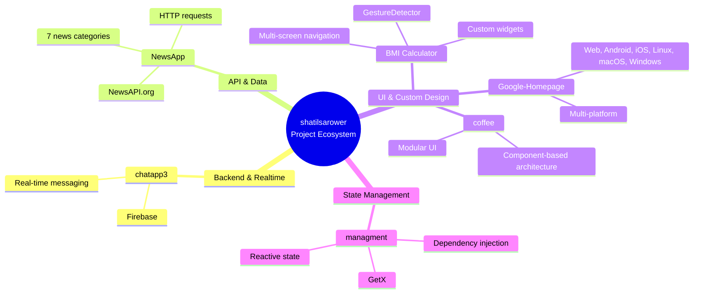

---

## 3. Project 1: chatapp3 — Firebase-Powered Chat

**Repository:** [https://github.com/shatilsarower/chatapp3](https://github.com/shatilsarower/chatapp3)

### 3.1 Description

A Flutter chat application built on **Firebase** as the backend. The project demonstrates real-time data synchronization, user authentication, and cloud messaging — the core building blocks of a production chat system.

### 3.2 Architecture Flow

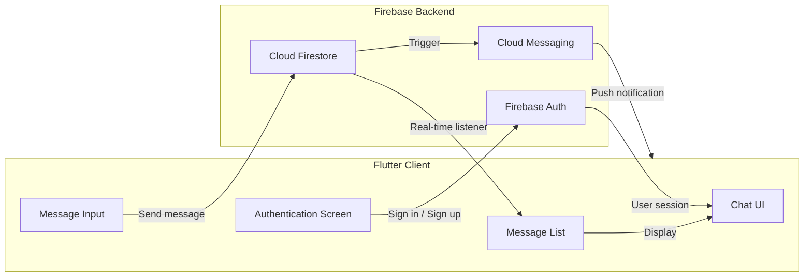

### 3.3 Key Technical Decisions

| Decision | Rationale |
|---|---|
| **Firebase Auth** | Offloads authentication complexity; supports email/password and federated providers. |
| **Cloud Firestore** | Real-time listeners eliminate the need for polling; offline persistence improves reliability on unstable networks. |
| **Flutter UI** | Single codebase for Android and iOS; hot reload accelerates iteration on chat interactions. |

---

## 4. Project 2: NewsApp — API-Driven News Reader

**Repository:** [https://github.com/shatilsarower/NewsApp](https://github.com/shatilsarower/NewsApp)

### 4.1 Description

A Flutter application that displays **7 types of news** fetched from the **NewsAPI.org** REST API. It demonstrates HTTP requests, JSON parsing, model classes, and dynamic list rendering.

### 4.2 Data Flow

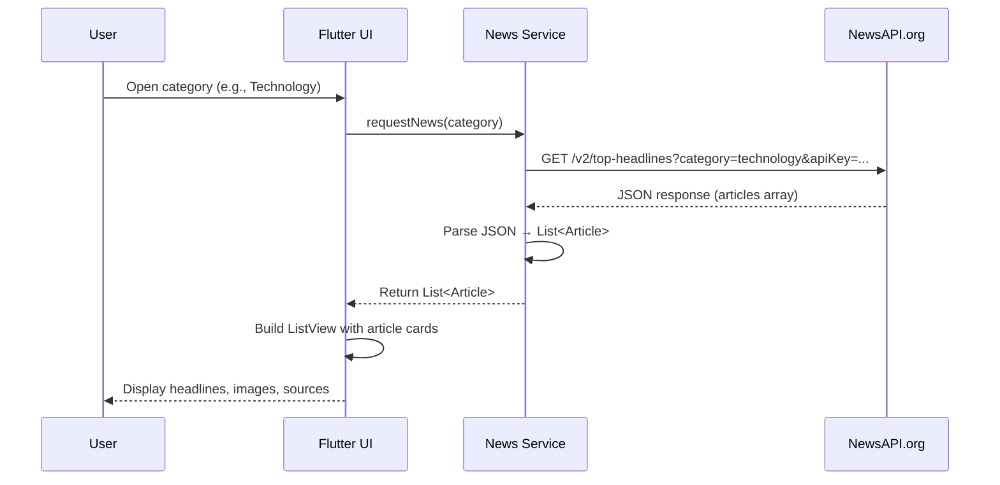

### 4.3 Category Routing

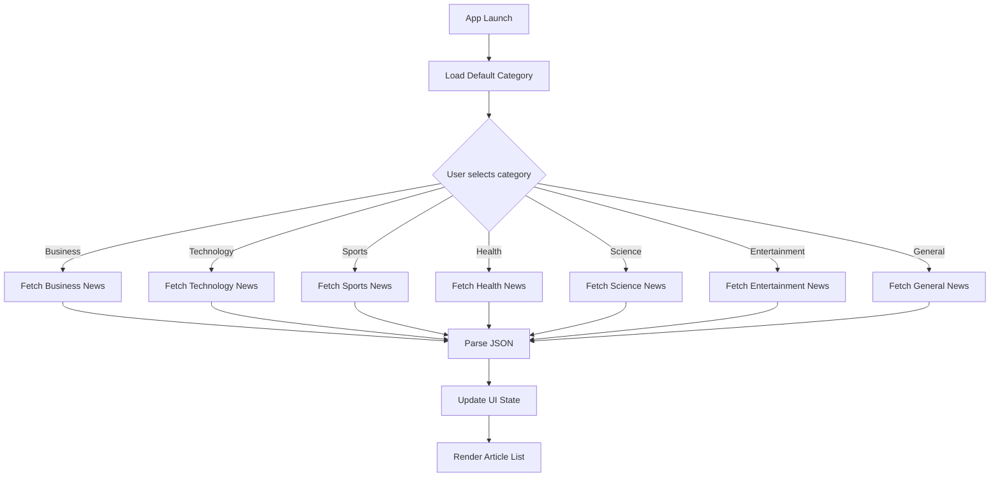

### 4.4 Key Learning Outcomes

- Consuming a third-party REST API with `http` package
- Handling asynchronous operations with `FutureBuilder` and `async/await`
- Mapping JSON to Dart model classes
- Managing loading, success, and error states in the UI

---

## 5. Project 3: BMI Calculator — Custom Flutter UI

**Repository:** [https://github.com/shatilsarower/bmi-calculator](https://github.com/shatilsarower/bmi-calculator)

### 5.1 Description

A multi-screen Body Mass Index calculator inspired by a **Ruben Vaalt** design. The project focuses on **custom widget composition**, **theme consistency**, and **navigation** rather than complex business logic.

### 5.2 Screen Navigation Flow

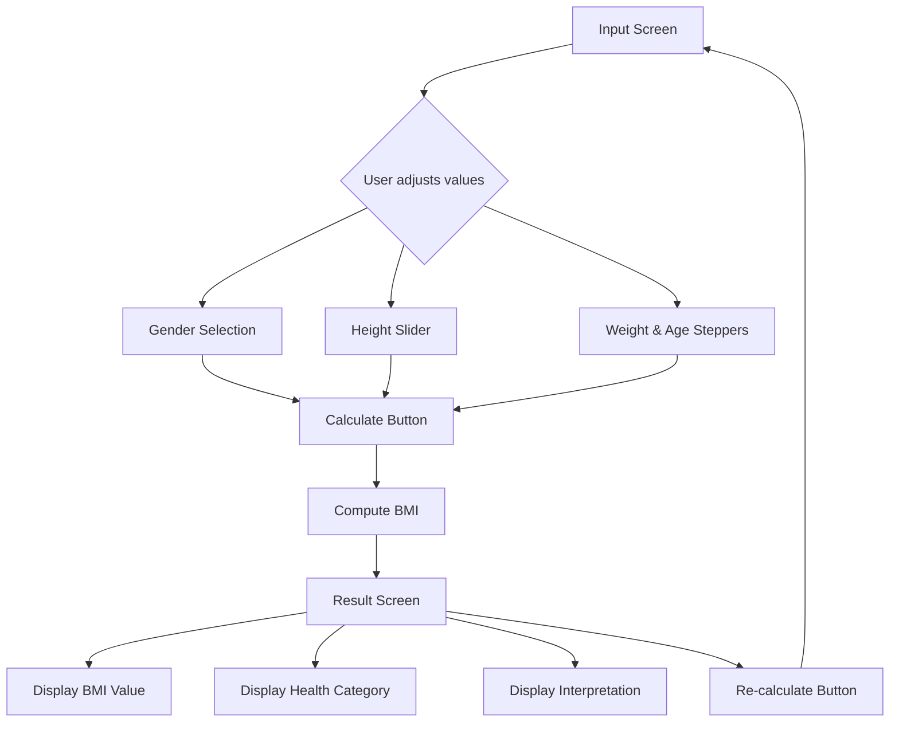

### 5.3 Widget Composition Strategy

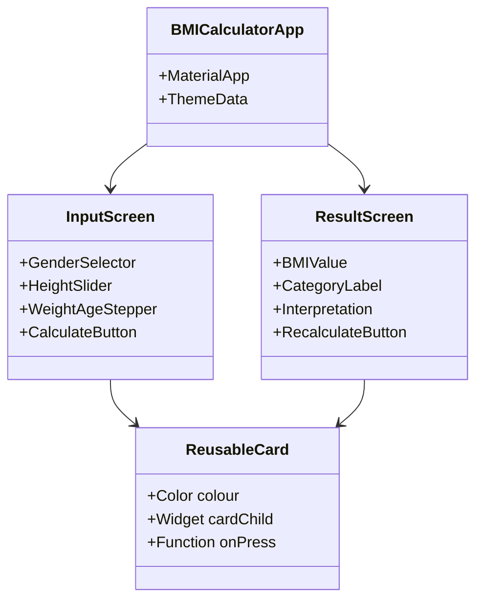

### 5.4 What the Project Demonstrates

- Flutter themes for coherent branding
- Multi-page apps with `Navigator` and routes
- Extracting and refactoring widgets
- Passing functions as parameters
- `GestureDetector` for non-tap gestures
- Custom colour palettes with hex codes
- `const` vs `final` in Dart

---

## 6. Project 4: managment — GetX State Management

**Repository:** [https://github.com/shatilsarower/managment](https://github.com/shatilsarower/managment)

### 6.1 Description

A dedicated exploration of **state management in Flutter using GetX**. The project serves as a learning ground for reactive state, dependency injection, and context-free navigation.

### 6.2 GetX Reactive State Flow

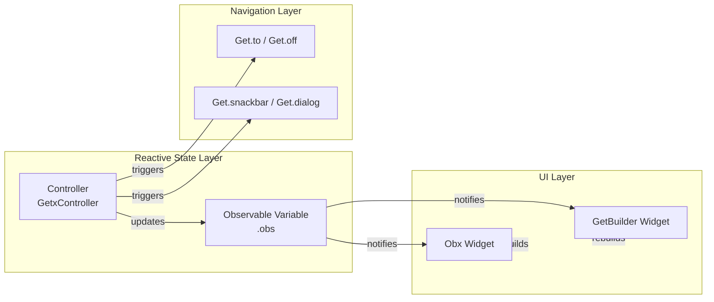

### 6.3 Dependency Injection with GetX

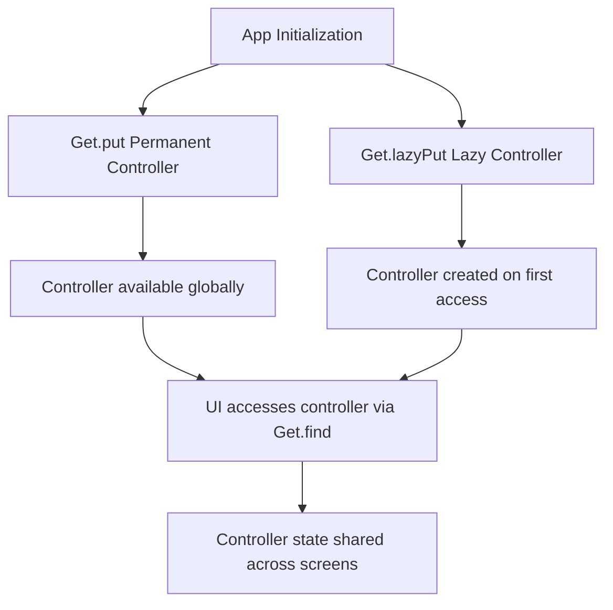

### 6.4 Key Learning Outcomes

- `GetxController` lifecycle management
- Reactive state with `.obs` and `Obx`
- Dependency injection with `Get.put`, `Get.lazyPut`, and `Get.find`
- Context-free navigation and dialogs/snackbars/bottom sheets
- Separation of business logic from UI

---

## 7. Project 5: coffee — Flutter UI Showcase

**Repository:** [https://github.com/shatilsarower/coffee](https://github.com/shatilsarower/coffee)

### 7.1 Description

A visually rich, coffee-themed Flutter UI concept. The project demonstrates **clean, modular UI design**, smooth transitions, and component-based architecture. It is intended as both inspiration and a foundation for UI-centric Flutter experiments.

### 7.2 UI Screen Flow

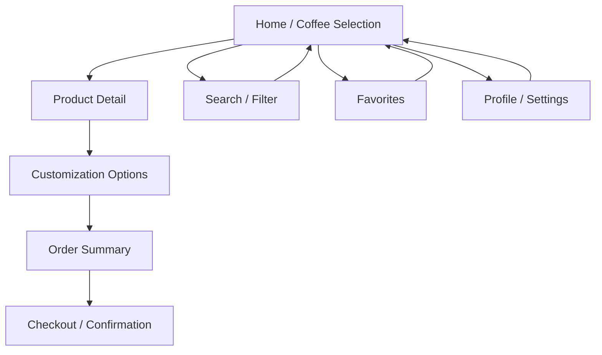

### 7.3 Modular Architecture

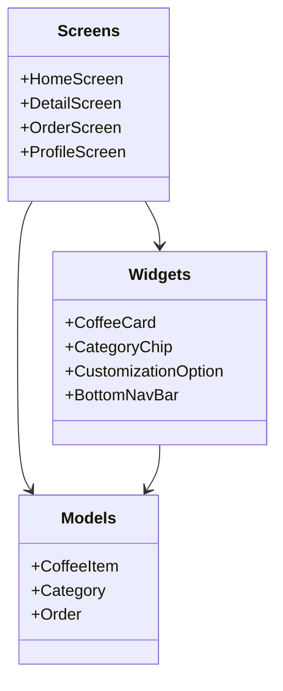

### 7.4 Project Structure

```
coffee/
├── android/
├── ios/
├── lib/
│   ├── screens/
│   ├── widgets/
│   ├── models/
│   └── main.dart
├── asstes/
│   └── image/
├── test/
├── pubspec.yaml
├── CONTRIBUTING.md
├── SECURITY.md
└── README.md
```

> The project follows Flutter and Dart conventions with linting rules enabled via `analysis_options.yaml`. It is open-source under the **MIT License**.

---

## 8. Project 6: Google-Homepage — Multi-Platform Flutter Clone

**Repository:** [https://github.com/shatilsarower/Google-Homepage](https://github.com/shatilsarower/Google-Homepage)

### 8.1 Description

A Flutter clone of the **Google homepage**, built to explore **multi-platform deployment**. The repository contains platform-specific folders for **Android, iOS, Linux, macOS, Web, Windows**, and **test** — demonstrating Flutter’s cross-platform reach beyond mobile.

### 8.2 Multi-Platform Build Targets

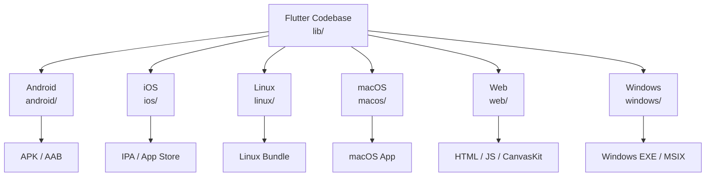

### 8.3 UI Layout Structure

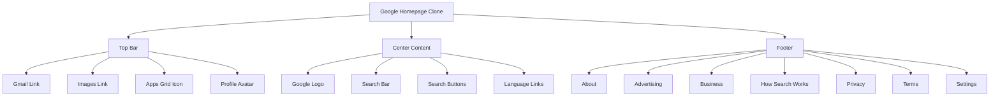

### 8.4 Key Learning Outcomes

- Flutter web rendering modes (HTML vs CanvasKit)
- Platform-specific folder structure and build configuration
- Responsive layout that adapts across screen sizes
- Web font loading and asset management across platforms

---

## 9. Downloadable Files

All files referenced in this README are available for download directly from the repository and GitHub’s raw file service.

### 9.1 Download the README

| Format | Download Link |
|---|---|
| **Markdown (this file)** | [Download `README.md`](https://raw.githubusercontent.com/shatilsarower/shatilsarower.github.io/master/README.md) |
| **Repository archive (ZIP)** | [Download full repository ZIP](https://github.com/shatilsarower/shatilsarower.github.io/archive/refs/heads/master.zip) |
| **Portfolio HTML** | [Download `index.html`](https://raw.githubusercontent.com/shatilsarower/shatilsarower.github.io/master/index.html) |

### 9.2 Download Individual Projects

| Project | Clone Command | ZIP Download |
|---|---|---|
| **chatapp3** | `git clone https://github.com/shatilsarower/chatapp3.git` | [Download ZIP](https://github.com/shatilsarower/chatapp3/archive/refs/heads/master.zip) |
| **NewsApp** | `git clone https://github.com/shatilsarower/NewsApp.git` | [Download ZIP](https://github.com/shatilsarower/NewsApp/archive/refs/heads/master.zip) |
| **bmi-calculator** | `git clone https://github.com/shatilsarower/bmi-calculator.git` | [Download ZIP](https://github.com/shatilsarower/bmi-calculator/archive/refs/heads/master.zip) |
| **managment** | `git clone https://github.com/shatilsarower/managment.git` | [Download ZIP](https://github.com/shatilsarower/managment/archive/refs/heads/master.zip) |
| **coffee** | `git clone https://github.com/shatilsarower/coffee.git` | [Download ZIP](https://github.com/shatilsarower/coffee/archive/refs/heads/master.zip) |
| **Google-Homepage** | `git clone https://github.com/shatilsarower/Google-Homepage.git` | [Download ZIP](https://github.com/shatilsarower/Google-Homepage/archive/refs/heads/master.zip) |

### 9.3 Download Mermaid Diagrams

The Mermaid diagrams in this README can be rendered in any Markdown viewer that supports Mermaid (GitHub, GitLab, VS Code with extensions, Obsidian, Notion). To download the raw Mermaid source for a specific diagram, copy the code block into a `.mmd` file and open it with the [Mermaid Live Editor](https://mermaid.live/).

---

## 10. License & Attribution

### 10.1 Repository License

No root-level `LICENSE` file is visible in the `shatilsarower.github.io` repository. The site includes third-party libraries and theme assets. Before redistributing the repository or reusing its theme assets in another project:

- Confirm the license of the original portfolio theme.
- Preserve required copyright and license notices.
- Confirm the licenses for Bootstrap, jQuery, Popper, Modernizr, Animate.css, LineIcons, Font Awesome, and any other bundled assets.
- Add a repository-level license only when the repository owner has the rights to license all content covered by it.

### 10.2 Project Licenses

| Project | License |
|---|---|
| **coffee** | MIT License |
| **bmi-calculator** | Companion project to The App Brewery’s Complete Flutter Development Bootcamp |
| **Google-Homepage** | No explicit license stated |
| **chatapp3** | No explicit license stated |
| **NewsApp** | No explicit license stated |
| **managment** | Includes `SECURITY.md`; no explicit license stated |

### 10.3 Third-Party Acknowledgments

- **Flutter** and **Dart** teams for the framework and tooling.
- **Bootstrap** and **jQuery** for the portfolio’s responsive foundation.
- **Font Awesome** and **Google Fonts** for iconography and typography.
- **Ruben Vaalt** for the BMI Calculator design inspiration.
- **NewsAPI.org** for the news data API.
- **Firebase** for backend infrastructure in `chatapp3`.
- **GetX** community for state management patterns in `managment`.

---

> 
